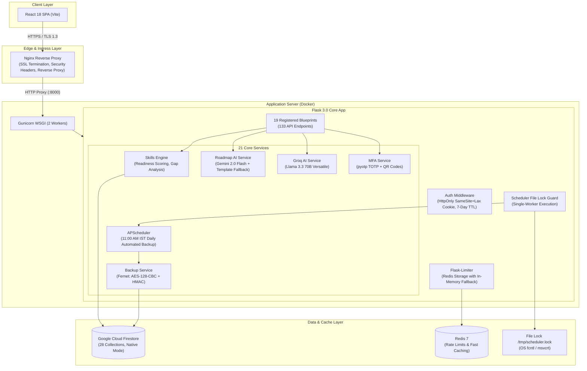

# SkillBridge Suite - REST Backend 🚀

A production-grade REST API backend for the SkillBridge AI career development, skill gap analysis, and personalized learning platform. Built with Python 3.12, Flask 3.0, Google Cloud Firestore, and Google Gemini AI.

---

## ⚡ Deployment & Hosting Status

> [!NOTE]
> **Deployment Status: Demo VM May Be Stopped (Archived to Conserve Cloud Costs)**  
> The backend was provisioned and verified on a Google Cloud Compute Engine VM (`skillbridge-server.asolvitra.tech`, `e2-medium`, 2 vCPU, 4 GB RAM) with Let's Encrypt SSL, Nginx, and Docker Compose. To eliminate ongoing cloud compute charges, the demo VM is currently stopped. The platform is clean, verified with automated tests, and runnable locally or containerized via `./scripts/deploy.sh compose`.

---

## 🏗️ Architecture & Verified Specifications



- **Registered Blueprints (19)**: Explicitly registered in `app/__init__.py`:
  `auth` (`/auth`), `users` (`/users`), `skills` (`/skills`), `roles` (`/roles`), `roadmap` (`/roadmap`), `learning` (`/learning`), `jobs` (`/jobs`), `activity` (`/activity`), `settings` (`/settings`), `user-state` (`/user-state`), `courses` (`/courses`), `mfa` (`/mfa`), `email` (`/email`), `certificate` (`/certificate`), `assessment` (`/assessment`), `learning-journey` (`/`), `assistant` (`/assistant`), `gamification` (`/gamification`), `admin` (`/admin`).
- **Endpoints Count**: **133 Route Handlers** (1 diagnostic `/health` + 132 handlers across 19 Blueprints).
- **Backend Services (21)**: Modules in `app/services/`: `activity_logger`, `adzuna_service`, `backup_service`, `email_service`, `fast_roadmap_generator`, `firebase_service`, `github_service`, `groq_service`, `interview_service`, `jobs_service`, `learning_assistant_service`, `learning_service`, `mfa_service`, `mock_jobs_service`, `module_service`, `project_service`, `quiz_service`, `resume_service`, `roadmap_ai`, `skills_engine`, `user_state_manager`.
- **Firestore Collections (28)**: Verified collection references in codebase:
  `users`, `user_state`, `user_profiles`, `user_roadmaps`, `user_activities`, `user_settings`, `user_assessments`, `user_courses`, `user_mfa`, `skills`, `master_skills`, `skills_ontology`, `skills_analysis`, `roadmaps`, `jobs`, `trending_jobs`, `analytics_events`, `learning_progress`, `mentorship_sessions`, `career_paths`, `resumes`, `gamification`, `projects`, `roles`, `interview_sessions`, `refresh_tokens`, `system_backups`, `system_metadata`.
- **Authentication & Sessions**: Firebase Google OAuth integration with dual transport: Bearer authorization headers and secure `HttpOnly`, `SameSite=Lax` session cookies (`sb_session`) with a 7-day TTL (604,800 seconds).
- **Artificial Intelligence**:
  - **Google Gemini 2.0 Flash**: Curriculum synthesis and personalized roadmap generation with algorithmic pre-compiled template fallback.
  - **Groq Llama 3.3 70B Versatile**: Interactive learning assistant and real-time chat guidance.
- **Multi-Factor Authentication (MFA/TOTP)**: Fully implemented and registered at `/mfa`. Uses `pyotp` for RFC 6238 TOTP generation and verification, `qrcode[pil]` for authenticator QR generation, PBKDF2/Fernet encrypted secret storage, and SHA-256 hashed recovery backup codes.
- **Disaster Recovery & Backups**: Daily automated encrypted snapshots at 11:00 AM IST via `BackupService`. Uses Fernet cryptography (**AES-128-CBC with PKCS7 padding and HMAC-SHA256 authenticated integrity**). Encrypted data is partitioned into **800KB chunks** to obey Firestore 1MB document quotas, pruned to keep exactly 10 retained snapshots, with dry-run decryption validation before live rollback (`scripts/backup-restore.sh`).
- **Scheduler Concurrency Guard**: APScheduler is wrapped with an OS-level non-blocking file lock (`fcntl.flock` on Unix, `msvcrt` on Windows). Exactly one Gunicorn worker acquires the lock; all other workers skip initialization, eliminating duplicate backup jobs.
- **Database Reliability Policy**: **Strict Fail-Closed**. When Firestore is unavailable or credentials are missing in production mode, requests immediately fail closed and return `HTTP 503 DATABASE_UNAVAILABLE`. In-memory mocking is explicitly prohibited unless `ALLOW_MOCK_DB=true` is set.
- **Rate Limiting**: Distributed rate limiting via `Flask-Limiter` with `REDIS_URL` storage and in-memory fallback. Configured defaults: `1000 per hour, 100 per minute` globally; `5 per minute` on `/auth/login` and `/auth/register`.

---

## 🧪 Automated Testing

Automated test suites cover core business logic, skills engine scoring, authentication cookie lifecycles, and roadmap schema validation:

```bash
# Run unit and integration test suite
pytest tests/

# Run with verbose output
pytest -v tests/
```

### Verified Test Results (Command: `pytest tests/`)
- **Collected**: 23 items
- **Passed**: **18 passed**
- **Skipped**: **5 skipped** (live smoke tests in `tests/smoke/test_smoke_api.py`, which only run when `API_URL` is set)
- **Execution Time**: ~2.6 seconds

```text
tests\smoke\test_smoke_api.py sssss                                      [ 21%]
tests\test_auth.py ......                                                [ 47%]
tests\test_roadmap.py ......                                             [ 73%]
tests\test_skills_engine.py ......                                       [100%]
================== 18 passed, 5 skipped in 2.61s ==================
```

### Running Live Smoke Tests Against a Target
```bash
# Set target server URL and run smoke tests
API_URL=http://localhost:8000 pytest tests/smoke/ -v
```

---

## 🚀 Local Setup & Development

### 1. Prerequisites
- Python 3.11 or 3.12
- Node.js >= 20 (for frontend)
- (Optional) Docker & Docker Compose

### 2. Installation
```bash
# Create and activate virtual environment
python -m venv venv
# On Windows:
.\venv\Scripts\Activate.ps1
# On Linux/macOS:
source venv/bin/activate

# Install locked dependencies
pip install -r requirements.txt
```

### 3. Environment Configuration
```bash
cp .env.example .env
```
Edit `.env` with your API credentials. For local offline development without live Firebase/GCP credentials, enable:
```ini
ALLOW_MOCK_DB=true
DISABLE_FIREBASE=true
DISABLE_SCHEDULER=true
```

### 4. Running the Backend
```bash
python run.py
```
Health probe available at: `http://localhost:8000/health`.

---

## 🚢 Canonical Deployment Scripts

All operational and deployment tasks are consolidated into documented scripts in `scripts/`:

```
backend/scripts/
├── deploy.sh              # Build & run stack with Docker Compose
├── vm-setup.sh            # Idempotent GCP VM setup (Docker, Nginx, SSL)
├── verify-deployment.sh   # Post-deployment health & connectivity probe
├── backup-restore.sh      # Backup CLI (backup, list, dry-run, restore)
├── backup_cli.py          # Python bridge for BackupService
├── benchmark_endpoints.py # Latency benchmark tool (p50 / p95)
├── count_endpoints.py     # Endpoint audit tool
└── find_collections.py    # Firestore collection audit tool
```

### Usage
```bash
# Production Docker Compose run
./scripts/deploy.sh compose

# Verify running deployment
./scripts/verify-deployment.sh

# Provision an Ubuntu VM on Google Compute Engine
sudo ./scripts/vm-setup.sh

# Disaster recovery CLI
./scripts/backup-restore.sh backup
./scripts/backup-restore.sh list
./scripts/backup-restore.sh dry-run <SNAPSHOT_ID>
./scripts/backup-restore.sh restore <SNAPSHOT_ID>
```

---

## 📈 Latency Benchmarks

Measured via local benchmark (`scripts/benchmark_endpoints.py`, 50 requests/endpoint, `ALLOW_MOCK_DB=true`):
- `GET /health`: **p50 = 0.35 ms**, p95 = 0.62 ms
- `GET /skills/master`: **p50 = 0.65 ms**, p95 = 1.37 ms
- `GET /roles/categories`: **p50 = 0.43 ms**, p95 = 1.03 ms
- `GET /roadmap/templates`: **p50 = 1.29 ms**, p95 = 2.84 ms